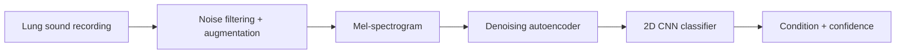

# Auscura — AI for Lung Sound Diagnostics

[](#results)
[](#results)
[](#roadmap)

**Auscura** listens to the chest the way a clinician does with a stethoscope, then uses deep learning to flag likely respiratory conditions from the recording.

This page shares the research behind Auscura and the results so far. The source code and models are developed privately.

> ⚠️ **Research stage.** Auscura is not a medical device and has not been clinically validated.

---

## The problem

Auscultation (listening to breath sounds) is the cheapest and most widely available lung exam there is. It is also subjective, and it depends heavily on the listener's experience. Respiratory diseases such as **COPD, asthma and pneumonia** are among the leading causes of death worldwide, and many patients are first seen in settings without a pulmonologist.

An objective, automated second opinion on a recording from a digital stethoscope could support:

- **Screening** in primary care and rural clinics
- **Telemedicine**, where the recording is captured remotely and analysed centrally
- **Training** for medical students learning to recognise abnormal sounds

## Approach



Each recording is filtered, converted into a time–frequency image (a mel-spectrogram), cleaned by a denoising autoencoder, then classified by a convolutional neural network into one of five classes: **Asthma, Bronchial, COPD, Healthy, Pneumonia**.

## Results

First-generation model, evaluated on a held-out test set (15% split, 182 recordings) of the public [Asthma Detection Dataset v2](https://www.kaggle.com/datasets/mohammedtawfikmusaed/asthma-detection-dataset-version-2) (1,211 recordings in total).

| Metric             | Score  |
| ------------------ | ------ |
| Accuracy           | 95.05% |
| Weighted F1        | 95.08% |
| Weighted precision | 95.15% |
| Macro ROC AUC      | 99.70% |

### Per class

| Condition | Precision | Recall  | F1     | ROC AUC | Test samples |
| --------- | --------- | ------- | ------ | ------- | ------------ |
| COPD      | 100.00%   | 96.83%  | 98.39% | 99.92%  | 63           |
| Bronchial | 93.33%    | 100.00% | 96.55% | 99.91%  | 14           |
| Pneumonia | 93.75%    | 93.75%  | 93.75% | 99.47%  | 48           |
| Asthma    | 92.31%    | 92.31%  | 92.31% | 99.37%  | 39           |
| Healthy   | 89.47%    | 94.44%  | 91.89% | 99.80%  | 18           |

### Confusion matrix

```
                         Predicted
Actual       Asthma  Bronchial  COPD  Healthy  Pneumonia
Asthma         36        1        0      1         1
Bronchial       0       14        0      0         0
COPD            1        0       61      0         1
Healthy         0        0        0     17         1
Pneumonia       2        0        0      1        45
```

### Limitations

These results come from a single public dataset of preprocessed recordings, with a small test set (only 14 Bronchial and 18 Healthy samples). They have not been validated on external data or in a clinical setting. Closing that gap is the focus of the next phase.

## Roadmap

- [x] First-generation model: 5-class lung sound classification (95% test accuracy)
- [x] Research on ICBHI 2017 with RespireNet-style and hierarchical architectures
- [ ] Next-generation model trained on larger, multi-source datasets
- [ ] Clinician dashboard and inference API
- [ ] Real-time analysis from digital stethoscopes
- [ ] External and prospective clinical validation

## About

Auscura began as a final year project by [Abdul Hadi Waseem](https://github.com/Abdul-Hadi-Waseem) and is now being developed into a product.

Interested in collaborating, piloting, or partnering? Open an [issue](https://github.com/Abdul-Hadi-Waseem/auscura-research/issues) or reach out via [GitHub](https://github.com/Abdul-Hadi-Waseem).

Dataset credit: [Asthma Detection Dataset Version 2](https://www.kaggle.com/datasets/mohammedtawfikmusaed/asthma-detection-dataset-version-2), Mohammed Tawfik Musaed et al.
